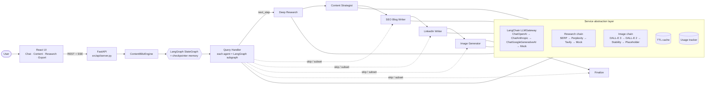

# ⚡ ContentBlitz: AI Content Marketing Assistant

A production-style **multi-agent content marketing system** built with **LangGraph** and **LangChain**. Six specialised agents
research a topic with cited sources, turn it into a structured report, write SEO-optimised blog posts,
craft LinkedIn posts with a hashtag strategy and generate on-brand visuals. They work through a
conversational **React** interface (served by a FastAPI backend) with memory, quality scoring and multi-provider fallbacks.

> Capstone project: *Applied Agentic AI for SWEs: AI Content Marketing Assistant*.
> Runs **fully offline out of the box** (deterministic mock providers), so evaluators can try every feature
> without API keys. Add keys to switch to GPT-4o / Claude / Gemini, SERP API / Perplexity / Tavily and DALL-E 3 / Stability.

---

## ✨ Highlights

| Capability | What you get |
|---|---|
| **6 specialised agents** | Query Handler · Deep Research · Content Strategist · SEO Blog Writer · LinkedIn Writer · Image Generator |
| **LangGraph + LangChain** | Each agent is its own **LangGraph subgraph** (parallel research fan-out, a blog self-correction loop, a LinkedIn length-guard loop) mounted in a supervising graph; model calls are LangChain `ChatPromptTemplate` → `ChatOpenAI` / `ChatAnthropic` / `ChatGoogleGenerativeAI` chains with Pydantic structured output |
| **Intelligent routing** | LLM router (cheap tier) with schema validation, plus a deterministic heuristic fallback; resolves follow-ups ("make it shorter", "turn *it* into a LinkedIn post") |
| **Research-first workflows** | Written content is automatically grounded in fresh research; research is reused across turns for the same topic |
| **Multi-provider fallbacks** | LLM (LangChain `with_retry` + `with_fallbacks`): OpenAI → Claude → Gemini → mock · Research: SERP API → Perplexity → Tavily → mock · Images: DALL-E 3 → DALL-E 2 → Stability → local placeholder |
| **Source credibility & fact-checking** | Every source gets a credibility rating; every finding and statistic is checked against the source it cites, and unconfirmed claims are flagged in the Research tab |
| **Observability & benchmarks** | LangSmith tracing of every agent node and model call (`LANGSMITH_TRACING=true`); `make bench` measures latency, cost and quality per provider configuration |
| **Resilience** | Exponential backoff with jitter, non-retryable auth errors, per-agent error isolation, graceful degradation |
| **Cost control** | 30-min TTL research cache, model tiers (mini for routing/meta/hashtags), usage & cost tracker in the UI |
| **SEO engine** | Keyword strategy, 1-2% density check, 150-160 char meta descriptions, H1/H2/H3 audit, internal-link suggestions, Flesch scores |
| **LinkedIn engine** | Hook-first templates, 1,300-1,600 character window, 8-12 hashtags, CTA detection, line-break optimisation |
| **Quality pipeline** | 0-100 scores per asset with sub-dimensions and suggestions; blogs below threshold are auto-refined |
| **Brand voice** | Configurable tone/audience/banned phrases, consistency checks, and **voice learning from sample content** |
| **Memory** | LangGraph checkpointer per conversation thread: in-memory by default, SQLite (`CONTENTBLITZ_MEMORY=sqlite`, the Docker default) to survive restarts; the browser remembers its conversation and restores it on reload |
| **Content series** | "Write a 3-part blog series about X" produces distinct, angle-driven parts |
| **Export** | Markdown · HTML · Plain text · PDF · WordPress WXR (CMS import) · scheduler JSON (Buffer/Hootsuite) · PNG |
| **Web UI** | React + TypeScript (Vite): chat with a live six-station agent pipeline, content editor with instant re-scoring, research panel with linked citations, exports, settings; responsive, dark mode |
| **Testing** | 155 Python tests (unit / API / integration / e2e incl. real-browser Playwright and the real `ChatOpenAI` client against a local OpenAI-compatible server), **96% coverage**, plus 17 Vitest component tests; CI on Python 3.11 & 3.12 |

---

## 🏗️ Architecture



The Query Handler produces a **plan** (an ordered subset of agents). After every node, the router function
`next_step` picks the next unfinished agent, so a single graph handles every workflow: research-only,
blog-only, image-only, refinements and full campaigns. See [docs/architecture.md](docs/architecture.md) and the
[technical design](docs/technical_design.md).

### Project structure

```
contentblitz/
├── src/
│   ├── agents/              # The six agents, each a LangGraph subgraph (+ base class)
│   │   ├── query_handler.py   research_agent.py   content_strategist.py
│   │   ├── blog_writer.py     linkedin_writer.py  image_generator.py
│   │   └── prompts.py (ChatPromptTemplates)  schemas.py (structured-output models)
│   ├── core/                # config.py, router.py, workflow.py (engine facade), resilience.py
│   ├── integrations/        # LLM gateway (LangChain) + search/image adapters with fallback chains
│   │   ├── llm_gateway.py (ChatOpenAI/ChatAnthropic/ChatGoogleGenerativeAI, retries, fallbacks, mock)
│   │   ├── base.py  openai_client.py (DALL-E)
│   │   ├── serp_client.py  perplexity_client.py (Perplexity, Tavily)
│   │   ├── image_clients.py (Stability, placeholder)  mock_client.py  service_factory.py
│   ├── utils/               # content_optimization.py, quality_validation.py, source_verification.py, templates.py, export_tools.py
│   ├── workflow/            # langgraph_workflow.py, state_management.py
│   ├── api/                 # FastAPI: REST + Server-Sent Events, serves the built UI
│   └── cli.py
├── frontend/                # React + TypeScript (Vite): src/components, src/api.ts, tests
├── scripts/benchmark.py     # latency / cost / quality per provider configuration
├── tests/{unit,integration,e2e}/
├── config/{services,development,production,test}.yaml
├── docs/                    # architecture, API, deployment, technical design, service comparison, demo script, benchmarks/
├── Dockerfile  docker-compose.yml  Makefile  requirements*.txt  .env.example
└── .github/workflows/ci.yml
```

---

## 🚀 Quick start

```bash
git clone https://github.com/prasannakoppolu/contentblitz-ai-assistant.git
cd contentblitz-ai-assistant
python -m venv .venv && source .venv/bin/activate
pip install -r requirements.txt
(cd frontend && npm ci && npm run build)        # Node 20+

# Option A: offline demo (no keys, no cost)
CONTENTBLITZ_MOCK=1 uvicorn src.api.server:app --port 8000

# Option B: real providers
cp .env.example .env     # add any keys you have; missing ones are skipped
uvicorn src.api.server:app --port 8000
```

Open http://localhost:8000. API keys can also be pasted into Settings; they stay in that browser tab's memory only.
To point at an OpenAI-compatible endpoint (Azure OpenAI, vLLM, Ollama), set `models.openai.base_url` in
`config/services.yaml`.

**Frontend development (hot reload):** run `make api` (FastAPI on :8000) and `make web` (Vite on :5173, proxying
`/api`), then open http://localhost:5173.

**Docker:** `docker compose up --build` (reads `.env` if present).
**Terminal:** `python -m src.cli --interactive --mock`.
**Tests:** `make dev`, then `pytest --cov` (Python, incl. browser e2e once the UI is built) and `make test-ui` (Vitest + typecheck).
**Benchmarks:** `make bench` (offline) or `make bench-live LABEL=balanced` (your keys); reports go to `docs/benchmarks/`.

### Environment variables

| Variable | Purpose |
|---|---|
| `OPENAI_API_KEY` | GPT-4o / GPT-4o-mini and DALL-E 3/2 |
| `ANTHROPIC_API_KEY` | Claude Sonnet / Haiku (LLM fallback #1) |
| `GOOGLE_API_KEY` | Gemini 2.0 Flash (LLM fallback #2) |
| `SERPAPI_API_KEY` · `PERPLEXITY_API_KEY` · `TAVILY_API_KEY` | Research engines |
| `STABILITY_API_KEY` | Stable Image Core (image fallback) |
| `APP_ENV` | `development` / `production` / `test`: selects `config/<env>.yaml` |
| `CONTENTBLITZ_MOCK` | `1` forces offline mode |
| `CONTENTBLITZ_OUTPUT_DIR` | Where images and metadata are saved (default `outputs/`) |
| `CONTENTBLITZ_MEMORY` | `memory` (default) or `sqlite` to keep conversations across server restarts |
| `CONTENTBLITZ_MEMORY_PATH` | SQLite file for conversation memory (default `contentblitz_memory.sqlite`; Docker: `/data/...`) |
| `LOG_LEVEL` | `DEBUG` / `INFO` / `WARNING` |
| `LANGSMITH_TRACING` · `LANGSMITH_API_KEY` · `LANGSMITH_PROJECT` | LangSmith tracing of every agent node and model call (optional) |

---

## 💬 Usage examples

| You say | Agents that run | Result |
|---|---|---|
| *Research the latest trends in sustainable packaging for e-commerce* | QH → Research → Strategist | Trend report with 10 cited sources (searched in parallel), stats, angles, keyword ideas; each source rated for credibility and each claim fact-checked |
| *Now write an SEO blog post about it* | QH → Blog (research reused) | ~1,500-word article, meta description, SEO + quality scores |
| *Make it shorter* | QH → Blog (refine) | Revision 2, re-scored |
| *Turn it into a LinkedIn post* | QH → LinkedIn | 1,300-1,600 chars, 8-12 hashtags, hook + CTA |
| *Create an image for the LinkedIn post* | QH → Image | Enhanced prompt → DALL-E 3 (or fallback), saved PNG + metadata |
| *Create a campaign about B2B podcast marketing* | All six | Report, blog, LinkedIn post and image in one turn |
| *Write a 3-part blog series about zero-party data* | QH → Research → Blog | Three distinct articles + WordPress XML export |
| *Write a listicle: 7 ways to improve email open rates* | QH → Research → Blog | Listicle template applied |
| *Give me a competitive analysis of project management tools* | QH → Research → Strategist | Competitive-analysis report template |

Programmatic use:

```python
from src.core.config import load_settings
from src.core.workflow import ContentBlitzEngine

engine = ContentBlitzEngine(load_settings())
state = engine.run("Create a campaign about urban beekeeping", thread_id="acme")
print(state["response"])
print(state["blog"]["quality"]["score"], state["linkedin"]["hashtags"], state["image"]["path"])
state = engine.run("make the LinkedIn post more casual", thread_id="acme")   # memory-aware follow-up
```

Full agent inputs/outputs and the HTTP API are documented in [docs/api_documentation.md](docs/api_documentation.md);
the live OpenAPI docs are at http://localhost:8000/docs.

---

## 🔁 Error handling & fallbacks

1. **Within a provider:** rate-limit, timeout, connection and 5xx errors retry with exponential backoff and jitter
   (LangChain `with_retry` for models, the same policy for search/image adapters); auth and bad-request errors fail fast.
2. **Across providers:** LangChain `with_fallbacks` (models) and `ProviderChain` (search, images) move to the next
   provider; every attempt is recorded and shown in the UI. Invalid structured output also triggers the fallback.
3. **Inside an agent's subgraph:** steps degrade on their own: heuristic routing if every model fails, an extractive
   research summary, research keywords when keyword generation fails, default hashtags, a template image prompt, and
   a placeholder image when a generated image can't be downloaded or validated.
4. **Across agents:** each agent node in the main graph is wrapped, so a failed agent is reported in the reply while
   the rest still deliver. Dependants (the strategist after failed research) are skipped cleanly.
5. **Last resort:** the offline mock model, mock search and the local placeholder renderer keep the app usable
   during a full outage.

## 💰 Performance & cost tips

- Research results are cached for 30 minutes by query. Repeat topics cost nothing.
- Routing, meta descriptions, hashtags and image prompts use the **fast** tier (GPT-4o-mini / Haiku / Flash);
  long-form writing uses **premium**. Edit tiers in `config/services.yaml`.
- Research for a topic is **reused across turns**, so a follow-up blog/LinkedIn post doesn't re-search.
- `max_refinement_loops` caps automatic rewrites (1 in dev, 2 in prod).
- Settings → **Usage since the server started** shows API calls, estimated cost, cache hits and the active writing chain
  for your provider configuration (`POST /api/usage` returns the full breakdown, including tokens).
- For development, Gemini Flash's free tier plus Tavily's free tier is the cheapest live configuration.
- Research searches run in parallel, so a research turn takes about as long as the slowest single search.
- Measure before you choose: `make bench-live LABEL=... ARGS="--llm anthropic"` writes a latency/cost/quality
  report to `docs/benchmarks/` (see [service comparison](docs/service_comparison.md)).

## 🛠️ Troubleshooting

| Symptom | Fix |
|---|---|
| Banner says *offline demo mode* | Offline mode is on (the default when the server has no keys). Add keys to `.env` or Settings → API keys, then untick **Offline demo mode** in Settings. |
| Page says *ContentBlitz can't reach its server* | The API isn't running (or not on :8000 for `make web`). Start it with `uvicorn src.api.server:app --port 8000`. |
| `{"detail":"Not Found"}` at http://localhost:8000/ | The UI isn't built. Run `cd frontend && npm ci && npm run build`, then restart the server. |
| Agent progress arrives all at once behind a proxy | Disable response buffering for `/api/threads/*/chat` (see the deployment guide). |
| Image shows a gradient card | All image providers failed or no key; check the *Provider attempts* table in Content → Image. |
| `AuthenticationError` / `auth error 401` in the server log or *Provider attempts* | Invalid key: auth errors are not retried, so the next provider is used. Fix the key. |
| `RateLimitError` / `rate limited (429)` warnings | Retried automatically with backoff on the same provider, then the next provider takes over; reduce concurrency or add another provider. |
| Research tab flags claims as *Figure not found in source* | The cited source's snippet doesn't contain the number. Open the source and confirm it before publishing; in offline mode most claims are flagged because the demo sources are generic. |
| Answers come from `mock` although keys are set | Check the server log for the provider error; also make sure `CONTENTBLITZ_MOCK` isn't `1` and *Offline demo mode* is unticked. |
| Follow-up applied to the wrong piece | Name it explicitly: *"make the **blog** shorter"*. |
| PDF export unavailable | `pip install reportlab`. |
| Conversation gone after a server restart | Set `CONTENTBLITZ_MEMORY=sqlite` (already set in Docker). |

## 📚 Documentation

- [Architecture](docs/architecture.md): components, agent subgraphs, data flow, state model, sequence diagrams
- [Technical design](docs/technical_design.md): decisions, trade-offs, retry/fallback patterns, fact-checking, quality pipeline, scalability
- [API documentation](docs/api_documentation.md): HTTP API, engine, every agent's subgraph and inputs/outputs, LLM gateway
- [Service comparison](docs/service_comparison.md): providers, cost-benefit, benchmark method and results, recommendations by budget
- [Benchmarks](docs/benchmarks/offline-mock.md): measured offline baseline; add live runs with `make bench-live`
- [Deployment guide](docs/deployment_guide.md): local, Docker, Railway/Render/Fly, monitoring
- [Demo script](docs/demo_script.md): the walkthrough to record for the submission video

## 🧭 Roadmap (stretch)

CMS publishing (WordPress REST / Ghost / Medium) on top of the existing WXR export, Buffer/Hootsuite scheduling via
the scheduler JSON payload, LLM-as-judge fact-checking against full source pages, and fine-tuned brand-voice models.
