# Architecture

ContentBlitz is a multi-agent content marketing system: a React single-page app talks to a FastAPI server, which runs a
**LangGraph** supervising graph whose six agents are each **LangGraph subgraphs** calling **LangChain** chat models.
This document goes from the outside in (C4 style), then covers the graphs, the LLM call path, the main request flows,
state, deployment and quality attributes. The reasoning behind the major choices is recorded as ADRs in
[`docs/adr/`](adr/README.md).

| Level | Diagram | What it answers |
|---|---|---|
| 1 | [System context](#1-system-context) | Who uses ContentBlitz and which external services it depends on |
| 2 | [Containers](#2-containers) | The deployable/runtime pieces and how they communicate |
| 3 | [Backend components](#3-backend-components) | Modules inside the API server and their dependencies |
| 4 | [Supervising graph](#4-supervising-graph) and [agent subgraphs](#5-agent-subgraphs) | How a request moves through the agents |
| – | [LLM call path](#6-llm-call-path-retries-and-fallbacks) | How retries and provider fallbacks work |
| – | [Request flows](#7-request-flows) | Chat streaming, human edits, a full campaign |
| – | [State](#8-state-model) · [Deployment](#9-deployment) · [Quality attributes](#10-quality-attributes) | Memory, runtime topology, cross-cutting concerns |

---

## 1. System context

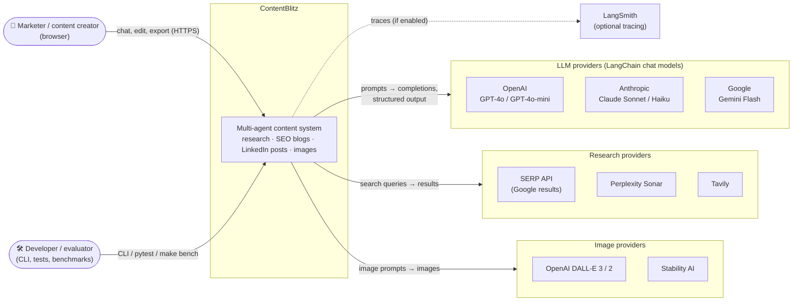

Every external service is optional: with no keys, ContentBlitz runs on built-in offline providers (a LangChain mock
chat model, mock search and a local image renderer), which is also how CI and the demo mode run.

---

## 2. Containers

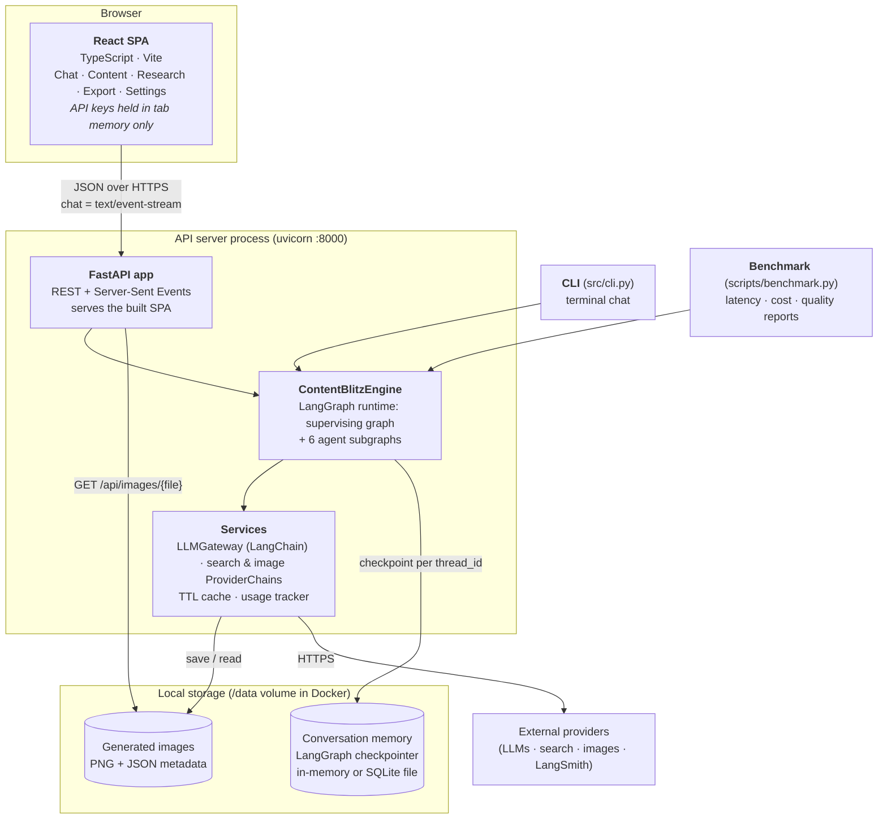

| Container | Technology | Responsibility |
|---|---|---|
| React SPA | React 18, TypeScript, Vite | Conversational UI with a live six-station agent pipeline, side-by-side editors with re-scoring, research panel with citations, fact-check badges and credibility ratings, exports, settings (offline mode, keys, provider priority, brand voice, usage) |
| FastAPI app | FastAPI, uvicorn, Pydantic | 12 endpoints (see [API docs](api_documentation.md)); streams per-agent progress over SSE; picks an engine per provider configuration via the `EngineRegistry`; strips server paths; serves the SPA |
| ContentBlitzEngine | LangGraph | Runs one conversational turn through the supervising graph; reads/writes checkpointed state |
| Services | LangChain, requests | Model calls with retries + fallbacks; search and image provider chains; caching; usage/cost accounting |
| Conversation memory | LangGraph `MemorySaver` / `SqliteSaver` | Per-thread state across turns (and restarts with SQLite) |
| CLI / benchmark | Python | Terminal chat; scenario benchmarks that write `docs/benchmarks/*.md` |

---

## 3. Backend components

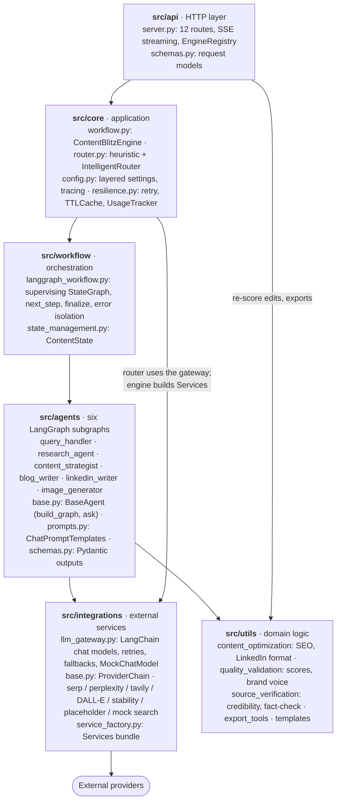

**Dependency rules:** API → core → workflow → agents → integrations/utils; arrows are package dependencies and
nothing depends upward. Agents never import a vendor SDK; they get
a `Services` bundle (`llm` = `LLMGateway`, `research`/`image` = `ProviderChain`s, cache, tracker), so every agent runs
unchanged offline and in tests.

---

## 4. Supervising graph

The engine's top-level LangGraph `StateGraph`. The Query Handler writes a **plan** (an ordered subset of agents); after
every node, the single routing function `next_step` sends control to the next unfinished agent or to `finalize`.

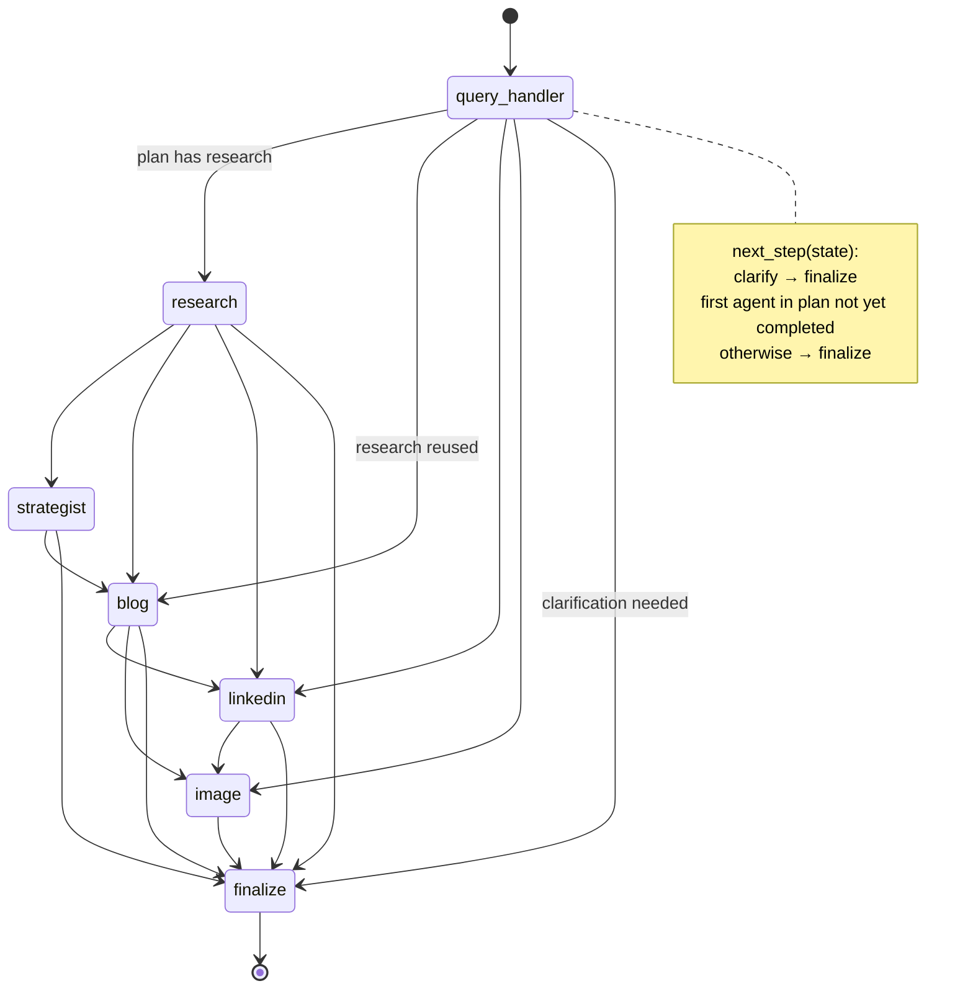

- **Canonical order** `research → strategist → blog → linkedin → image` guarantees each agent sees upstream context.
- **Error isolation:** each agent node is wrapped; a failure is recorded in `errors`, dependants are skipped
  (strategist after failed research), and the remaining agents still run. `finalize` composes the reply.
- **Examples:** "Research X" → `[research, strategist]`; "Now a blog about it" → `[blog]` (research reused);
  "Make it shorter" → `[blog]` in refine mode; "Create a campaign about X" → all five.

---

## 5. Agent subgraphs

Each agent is a compiled `StateGraph` with private state, invoked from its node in the supervising graph. LLM steps
are `ChatPromptTemplate | chat model` chains from the gateway; shapes in **bold** produce structured (Pydantic) output.

### Query Handler
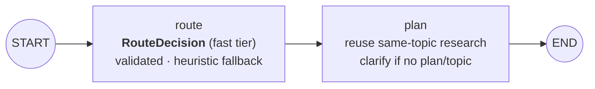

### Deep Research
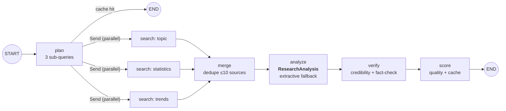

### Content Strategist
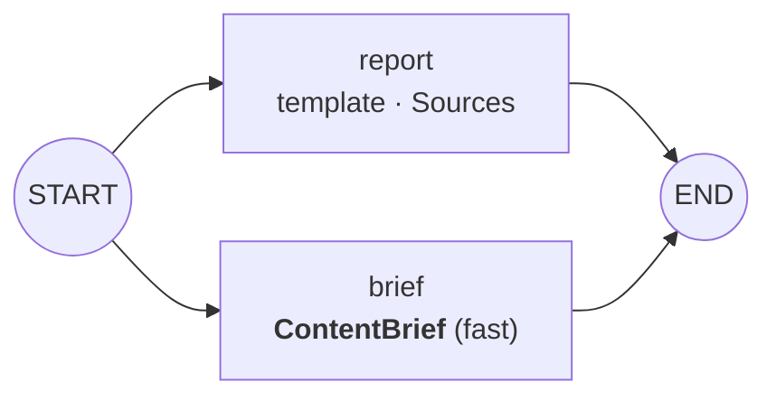

### SEO Blog Writer
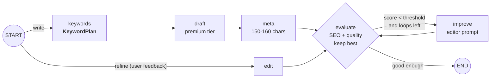
Series ("3-part blog series") run this subgraph once per part in parallel via `graph.batch`.

### LinkedIn Writer
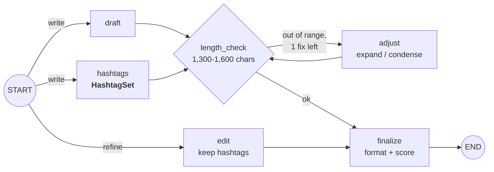

### Image Generator
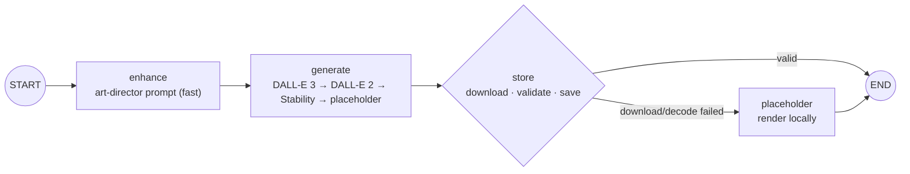

---

## 6. LLM call path: retries and fallbacks

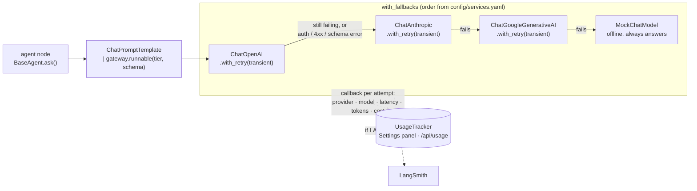

- **Retried on the same provider:** rate limit, timeout, connection and 5xx errors (exponential backoff with jitter,
  `max_retries` per environment). SDK-internal retries are disabled so this is the only policy.
- **Fail over immediately:** authentication, bad request, and structured output that fails schema validation.
- **Order** comes from `config/services.yaml`; providers without keys are skipped; the user can change the primary
  model in Settings. Search and image calls use the same idea through `ProviderChain`
  (SERP API → Perplexity → Tavily → mock; DALL-E 3 → DALL-E 2 → Stability → placeholder).

---

## 7. Request flows

### 7.1 Chat turn with live progress (SSE)

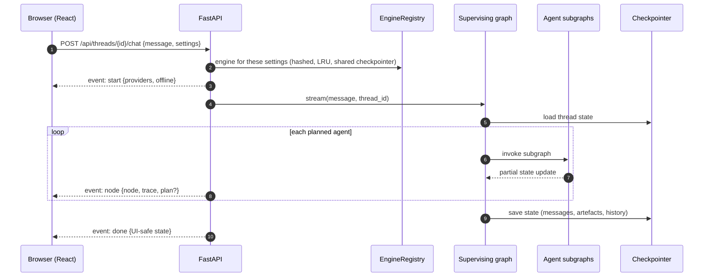

### 7.2 Human edit and re-score

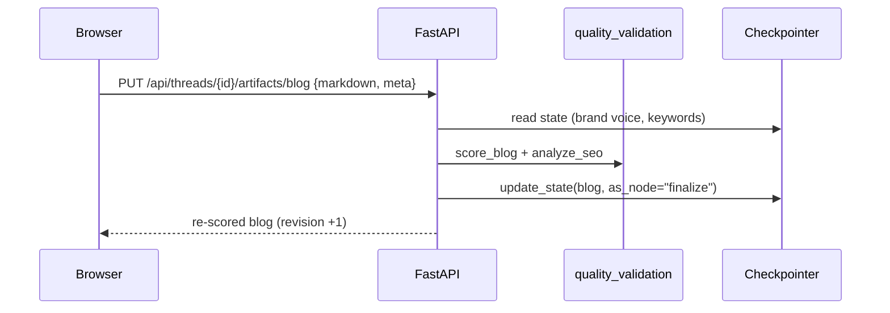

### 7.3 Research-first campaign

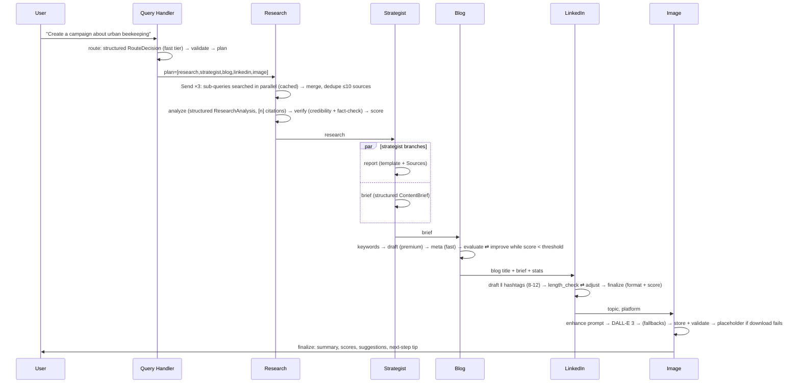

---

## 8. State model

`ContentState` (a `TypedDict`) is checkpointed per `thread_id`.

| Field | Lifetime | Notes |
|---|---|---|
| `messages` | conversation | `operator.add` reducer; user message added on input, assistant message on finalize |
| `user_query`, `route`, `plan`, `completed`, `errors`, `trace`, `topic`, `tone`, `templates`, `series_count`, `refine_target`, `feedback`, `needs_clarification`, `response` | turn | reset by the Query Handler |
| `research` (with `verification` and per-source `credibility`), `strategy_report`, `content_brief`, `blog`, `blog_series`, `linkedin`, `image` | conversation | artefacts, each tagged with its `topic` so stale artefacts are never reused for a new topic |
| `history` | conversation | `last_topic`, `last_agents`, `turn`, used for context-aware routing |
| `brand_voice` | conversation | per-thread override set from the UI (manual or learned) |

Memory is `MemorySaver` by default or `SqliteSaver` with `CONTENTBLITZ_MEMORY=sqlite` (the Docker default). The browser
stores its `thread_id` and restores the conversation on reload. Content-tab edits are written back with
`graph.update_state(..., as_node="finalize")`. See [ADR-0005](adr/0005-conversation-memory.md).

---

## 9. Deployment

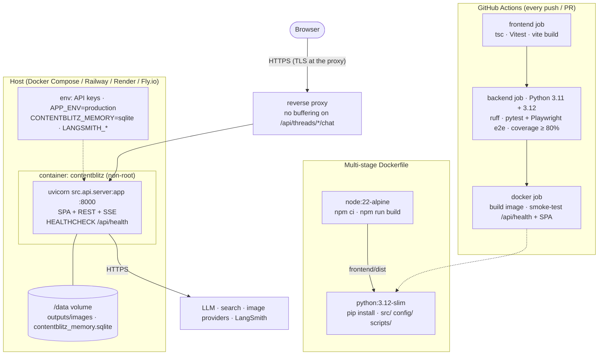

- **Single instance (default):** one container, SQLite memory and images on the `/data` volume.
- **Scaling out:** run several replicas behind the proxy, pass a shared LangGraph `PostgresSaver` as the registry's
  checkpointer, and move the TTL cache to Redis; generated images go to shared/object storage.
- **Development:** `make api` (FastAPI :8000) + `make web` (Vite :5173 proxying `/api`), or `make demo` offline.

---

## 10. Quality attributes

| Attribute | How the architecture provides it |
|---|---|
| Availability / resilience | Retries on transient errors, provider fallbacks for LLMs, search and images, offline providers last; per-agent error isolation; degradations inside subgraphs (heuristic routing, extractive research, placeholder image) |
| Performance | Parallel research searches, strategist branches, LinkedIn draft ‖ hashtags, parallel series parts; 30-minute search/research cache; research reused across turns; fast model tier for small tasks |
| Cost | Model tiers, caching, research reuse, capped auto-rewrites; per-call cost tracking; `make bench` reports |
| Content reliability | Research-first writing, `[n]` citations, source credibility ratings and claim verification, quality scores with auto-rewrite |
| Observability | Live pipeline in the UI, per-attempt usage tracker, structured logs, optional LangSmith traces of every node and model call |
| Security | Browser-held API keys sent per request, never stored or logged (engine selected by hashed config); no server paths in responses; image path-traversal checks; non-root container; CORS limited to dev origins |
| Testability | Every external dependency behind an interface with an offline implementation; 155 Python tests incl. subgraph structure and the real `ChatOpenAI` client against a local server; Playwright browser tests |
| Modifiability | Prompts in one module, Pydantic schemas for outputs, providers configured in YAML, new agents = new subgraph + plan entry |

## 11. Decision records

| ADR | Decision |
|---|---|
| [0001](adr/0001-agents-as-langgraph-subgraphs-with-langchain-models.md) | Agents as LangGraph subgraphs calling LangChain chat models |
| [0002](adr/0002-react-fastapi-sse-ui.md) | React SPA + FastAPI with Server-Sent Events instead of Streamlit |
| [0003](adr/0003-provider-retry-and-fallback-strategy.md) | Retry transient errors per provider, then fall back across providers, offline last |
| [0004](adr/0004-deterministic-fact-checking.md) | Deterministic source credibility and claim verification |
| [0005](adr/0005-conversation-memory.md) | Conversation memory with LangGraph checkpointers |
