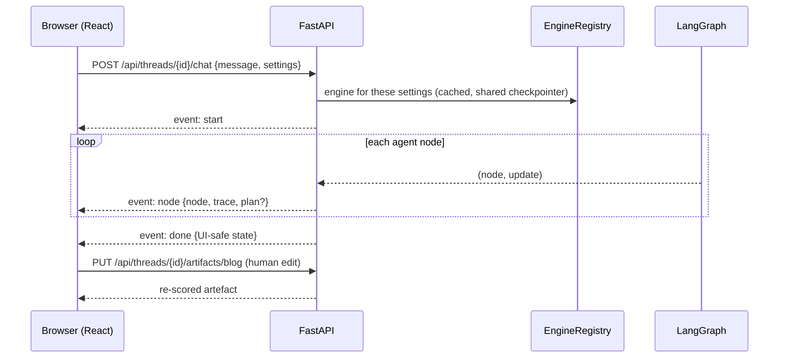
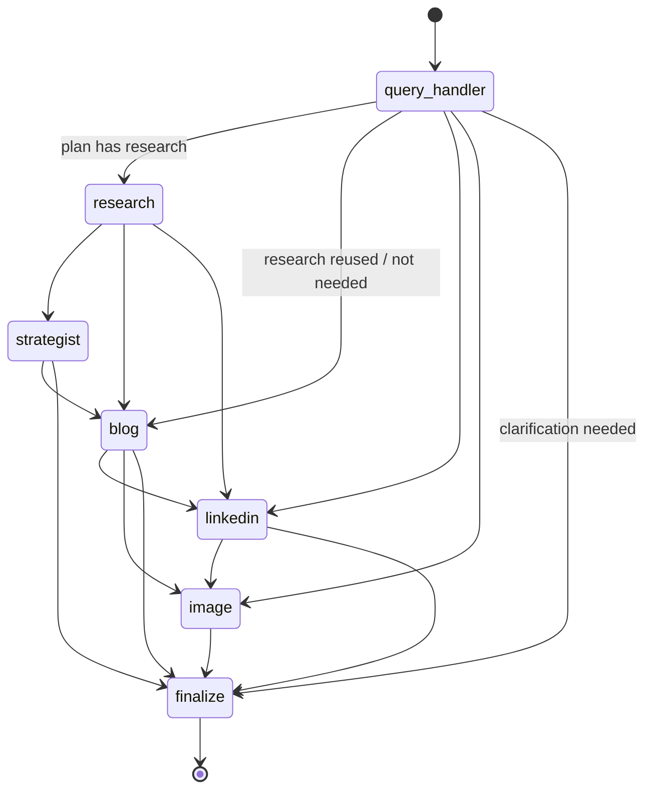
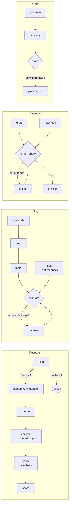
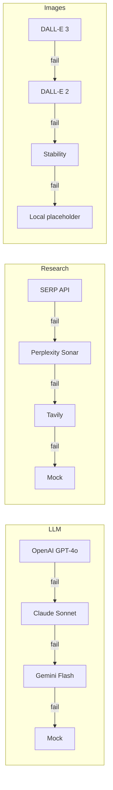

# Architecture

## 1. Layers

| Layer | Modules | Responsibility |
|---|---|---|
| Presentation | `frontend/` (React + TypeScript), `src/cli.py` | Chat with live pipeline, content editor (edit + re-score), research panel, export, settings |
| API | `src/api/server.py`, `schemas.py` | REST + Server-Sent Events over the engine; per-settings engine registry; serves the built SPA |
| Application | `src/core/workflow.py` (`ContentBlitzEngine`) | Facade: run/stream a turn, read state, persist human edits, usage |
| Orchestration | `src/workflow/langgraph_workflow.py`, `state_management.py` | LangGraph `StateGraph`, routing function, error isolation, finalisation, memory |
| Agents | `src/agents/*` | Six single-responsibility agents, **each a LangGraph subgraph**; prompts (`prompts.py`) and output schemas (`schemas.py`) |
| Domain utilities | `src/utils/*` | SEO analysis, LinkedIn formatting, quality scoring, brand voice, templates, export |
| Integration | `src/integrations/*` | `LLMGateway` (LangChain chat models + retries + fallbacks), search/image adapters with `ProviderChain` fallbacks, service factory |
| Cross-cutting | `src/core/config.py`, `resilience.py`, `router.py` | Layered config, retry/backoff, TTL cache, usage tracking, intent routing |

Agents never import a vendor SDK. They receive a `Services` bundle (`llm`, `research`, `image` chains + cache + tracker),
which keeps every agent unit-testable with mock providers and makes provider switching a config change.

## 1b. Web request flow



The browser keeps API keys in memory and sends them with each request; the server hashes the provider
configuration to pick (or build) an engine, so keys are never logged or persisted. Server file paths are stripped
from the state; images are served through `/api/images/{file}` with path-traversal checks.

## 2. Graph



All agent nodes share one conditional edge function:

```python
def next_step(state):
    if state["needs_clarification"]: return "finalize"
    for agent in state["plan"]:
        if agent not in state["completed"]: return agent
    return "finalize"
```

The canonical order `research → strategist → blog → linkedin → image` guarantees each agent sees its upstream
context (research → brief → blog title used by LinkedIn & image).

## 2b. Agent subgraphs

Every agent node in the graph above is itself a compiled LangGraph `StateGraph` with private state.



The Query Handler runs `route` (LangChain structured output → `RouteDecision`, heuristic fallback) → `plan`; the
Strategist runs `report` and `brief` as parallel branches. LLM steps are `ChatPromptTemplate | chat model` chains from
the `LLMGateway`.

## 3. State model (`ContentState`)

| Field | Lifetime | Notes |
|---|---|---|
| `messages` | conversation | `operator.add` reducer; user message added on input, assistant on finalize |
| `user_query`, `route`, `plan`, `completed`, `errors`, `trace`, `topic`, `tone`, `templates`, `series_count`, `refine_target`, `feedback`, `needs_clarification`, `response` | turn | reset by the Query Handler |
| `research`, `strategy_report`, `content_brief`, `blog`, `blog_series`, `linkedin`, `image` | conversation | artefacts; each is tagged with its `topic` so stale artefacts are never reused for a new topic |
| `history` | conversation | `last_topic`, `last_agents`, `turn`, used for context-aware routing |
| `brand_voice` | conversation | per-thread override set from the UI (manual or learned) |

State is checkpointed per `thread_id` by LangGraph: `MemorySaver` by default, or `SqliteSaver` when
`CONTENTBLITZ_MEMORY=sqlite` (the Docker default). The browser stores its `thread_id` and restores the conversation
on reload. Edits saved in the Content tab arrive via `PUT /api/threads/{id}/artifacts/*` and are written back with
`graph.update_state(..., as_node="finalize")`.

## 4. Sequence: research-first campaign

```mermaid
sequenceDiagram
    participant U as User
    participant QH as Query Handler
    participant R as Research
    participant S as Strategist
    participant B as Blog
    participant L as LinkedIn
    participant I as Image
    U->>QH: "Create a campaign about urban beekeeping"
    QH->>QH: LLM route (fast tier) → validate → plan
    QH->>R: plan=[research,strategist,blog,linkedin,image]
    R->>R: 3 sub-queries → search chain (cached) → dedupe ≤10 sources
    R->>R: LLM analysis → findings/stats with [n] citations → research score
    R->>S: research
    S->>S: template report + Sources; creative brief (keywords, angle, messages)
    S->>B: brief
    B->>B: keywords → template draft (premium) → meta (fast) → SEO audit → score → auto-refine?
    B->>L: blog title + brief + stats
    L->>L: hook/body → hashtags (8-12) → length guard → format → score
    L->>I: topic, platform
    I->>I: prompt enhancement → DALL-E 3 → (fallbacks) → download → validate → save PNG + JSON
    I->>U: finalize: summary, scores, suggestions, next-step tip
```

## 5. Provider fallback chains



LLM chains are LangChain `ChatOpenAI` / `ChatAnthropic` / `ChatGoogleGenerativeAI` models composed with
`.with_retry()` (transient errors only) and `.with_fallbacks()`; the offline mock is a LangChain `BaseChatModel`.
Search and image chains are `ProviderChain`s over HTTP adapters. Providers without keys are not instantiated, and
every attempt is recorded in the `UsageTracker` (and in LangSmith when tracing is on).

## 6. Technology choices & alternatives

| Concern | Choice | Alternatives considered | Why |
|---|---|---|---|
| Orchestration | LangGraph | CrewAI, AutoGen, Semantic Kernel | Explicit state machine, conditional edges, built-in checkpointing for memory |
| LLM | GPT-4o (+ Claude Sonnet, Gemini Flash) | — | Strong JSON mode & writing; alternates add resilience and cost options |
| Research | SERP API + LLM analysis | Perplexity Sonar, Tavily, You.com | Full control over sources and citation numbering; Perplexity/Tavily as fallbacks |
| Images | DALL-E 3 | DALL-E 2, Stability, Imagen, Midjourney | Best prompt adherence for marketing visuals; Midjourney has no official API |
| UI | React + TypeScript (Vite) behind FastAPI | Streamlit, Gradio, Vue | Full control of layout and interaction (live pipeline, side-by-side editing), proper responsive design, typed client, standard deploy story. Replaced the original Streamlit prototype |
| Streaming | Server-Sent Events | WebSockets, polling | One-way progress events fit SSE exactly; works through proxies, no extra protocol |
| Memory | LangGraph checkpointer | Redis, Postgres | Zero extra infra; swap in `SqliteSaver`/`PostgresSaver` for persistence |
| LLM integration | LangChain chat models (`ChatOpenAI`, `ChatAnthropic`, `ChatGoogleGenerativeAI`) | Raw HTTP, vendor SDKs | Structured output, `with_retry`/`with_fallbacks`, prompt templates and LangSmith tracing; one interface across providers |
| Search / image HTTP | `requests` adapters | LangChain community tools | Uneven LangChain coverage for SERP API/Perplexity/Stability; adapters share one retry policy |
