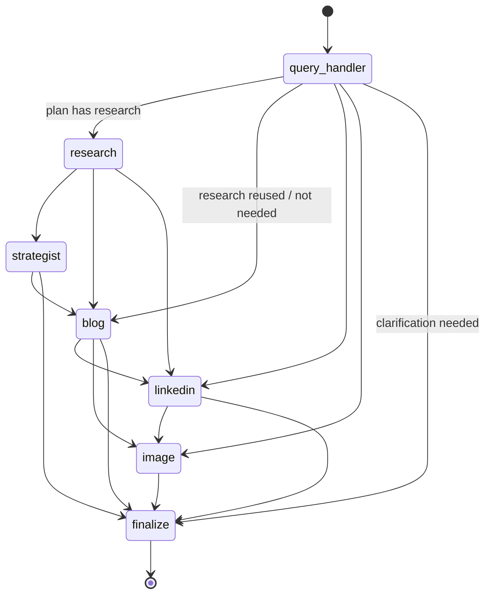
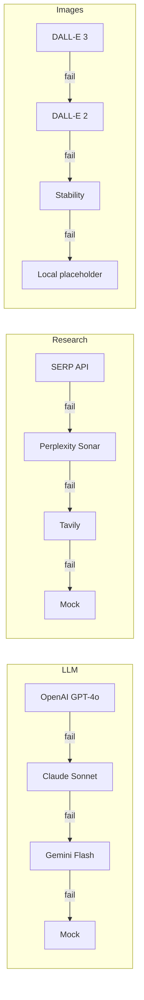

# Architecture

## 1. Layers

| Layer | Modules | Responsibility |
|---|---|---|
| Presentation | `src/web_app/*`, `src/cli.py` | Chat, content dashboard (edit + re-score), research panel, export, settings |
| Application | `src/core/workflow.py` (`ContentBlitzEngine`) | Facade: run/stream a turn, read state, persist human edits, usage |
| Orchestration | `src/workflow/langgraph_workflow.py`, `state_management.py` | LangGraph `StateGraph`, routing function, error isolation, finalisation, memory |
| Agents | `src/agents/*` | Six single-responsibility agents operating on shared state |
| Domain utilities | `src/utils/*` | SEO analysis, LinkedIn formatting, quality scoring, brand voice, templates, export |
| Integration | `src/integrations/*` | Provider adapters, `ProviderChain` fallbacks, service factory |
| Cross-cutting | `src/core/config.py`, `resilience.py`, `router.py` | Layered config, retry/backoff, TTL cache, usage tracking, intent routing |

Agents never import a vendor SDK. They receive a `Services` bundle (`llm`, `research`, `image` chains + cache + tracker),
which keeps every agent unit-testable with mock providers and makes provider switching a config change.

## 2. Graph



All agent nodes share one conditional edge function:

```python
def next_step(state):
    if state["needs_clarification"]: return "finalize"
    for agent in state["plan"]:
        if agent not in state["completed"]: return agent
    return "finalize"
```

The canonical order `research → strategist → blog → linkedin → image` guarantees each agent sees its upstream
context (research → brief → blog title used by LinkedIn & image).

## 3. State model (`ContentState`)

| Field | Lifetime | Notes |
|---|---|---|
| `messages` | conversation | `operator.add` reducer; user message added on input, assistant on finalize |
| `user_query`, `route`, `plan`, `completed`, `errors`, `trace`, `topic`, `tone`, `templates`, `series_count`, `refine_target`, `feedback`, `needs_clarification`, `response` | turn | reset by the Query Handler |
| `research`, `strategy_report`, `content_brief`, `blog`, `blog_series`, `linkedin`, `image` | conversation | artefacts; each is tagged with its `topic` so stale artefacts are never reused for a new topic |
| `history` | conversation | `last_topic`, `last_agents`, `turn`, used for context-aware routing |
| `brand_voice` | conversation | per-thread override set from the UI (manual or learned) |

State is checkpointed per `thread_id` by LangGraph (`MemorySaver`, or `SqliteSaver` for persistence).
Dashboard edits are written back with `graph.update_state(..., as_node="finalize")`.

## 4. Sequence: research-first campaign

```mermaid
sequenceDiagram
    participant U as User
    participant QH as Query Handler
    participant R as Research
    participant S as Strategist
    participant B as Blog
    participant L as LinkedIn
    participant I as Image
    U->>QH: "Create a campaign about urban beekeeping"
    QH->>QH: LLM route (fast tier) → validate → plan
    QH->>R: plan=[research,strategist,blog,linkedin,image]
    R->>R: 3 sub-queries → search chain (cached) → dedupe ≤10 sources
    R->>R: LLM analysis → findings/stats with [n] citations → research score
    R->>S: research
    S->>S: template report + Sources; creative brief (keywords, angle, messages)
    S->>B: brief
    B->>B: keywords → template draft (premium) → meta (fast) → SEO audit → score → auto-refine?
    B->>L: blog title + brief + stats
    L->>L: hook/body → hashtags (8-12) → length guard → format → score
    L->>I: topic, platform
    I->>I: prompt enhancement → DALL-E 3 → (fallbacks) → download → validate → save PNG + JSON
    I->>U: finalize: summary, scores, suggestions, next-step tip
```

## 5. Provider fallback chains



Providers without keys are not instantiated. Each provider call retries transient errors with exponential backoff
before the chain moves on. Every attempt is logged in `chain.attempts` and the `UsageTracker`.

## 6. Technology choices & alternatives

| Concern | Choice | Alternatives considered | Why |
|---|---|---|---|
| Orchestration | LangGraph | CrewAI, AutoGen, Semantic Kernel | Explicit state machine, conditional edges, built-in checkpointing for memory |
| LLM | GPT-4o (+ Claude Sonnet, Gemini Flash) | — | Strong JSON mode & writing; alternates add resilience and cost options |
| Research | SERP API + LLM analysis | Perplexity Sonar, Tavily, You.com | Full control over sources and citation numbering; Perplexity/Tavily as fallbacks |
| Images | DALL-E 3 | DALL-E 2, Stability, Imagen, Midjourney | Best prompt adherence for marketing visuals; Midjourney has no official API |
| UI | Streamlit | Gradio, React, Flask | Fastest path to a rich multi-panel UI in Python; testable with `AppTest` |
| Memory | LangGraph checkpointer | Redis, Postgres | Zero extra infra; swap in `SqliteSaver`/`PostgresSaver` for persistence |
| HTTP | `requests` adapters | vendor SDKs | Uniform retry/error semantics across 9 providers, fewer dependencies |
